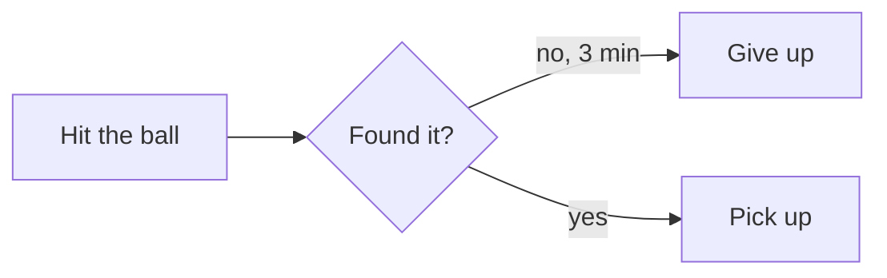

# mdprint

Markdown → PDF from the command line, with **mermaid diagrams**, **KaTeX math**, and typography that works for Chinese as well as English.

```bash
npm install -g mdprint
mdprint docs/*.md -o pdf/
```

Built on [md-to-pdf](https://github.com/simonhaenisch/md-to-pdf) and puppeteer. Requires Node.js ≥ 22.12.

## Install

```bash
npm install -g mdprint
```

mdprint renders with a headless Chrome that puppeteer downloads during installation. Recent npm versions may skip that install script. If mdprint says it can't find Chrome, run this once:

```bash
mdprint --install-browser
```

To use a Chrome you already have, set `PUPPETEER_EXECUTABLE_PATH` to its executable instead.

## Usage

```bash
mdprint README.md              # → README.pdf, next to the source
mdprint a.md b.md -o pdf/      # → pdf/a.pdf, pdf/b.pdf
mdprint docs/*.md -o pdf/      # let the shell expand the glob
```

| Option | |
|---|---|
| `-o, --out-dir <dir>` | Write PDFs into `<dir>` instead of next to each source file. Created if missing. |
| `--install-browser` | Download the headless Chrome that mdprint renders with. |
| `-h, --help` | Show help. |
| `-v, --version` | Show version. |

- Files render in parallel in a single browser.
- Relative image paths and links resolve against each Markdown file's own directory.
- If any file fails, the others still render and the exit code is 1.
- With `-o`, two inputs that share a file name (`a/README.md`, `b/README.md`) are rejected instead of silently overwriting each other.

## What you get

- A4 pages with page numbers in the footer.
- A CJK font stack (PingFang SC, Hiragino Sans GB, Microsoft YaHei) with system fallbacks.
- ` ```mermaid ` code blocks rendered as vector diagrams.
- `$...$` inline and `$$...$$` display math, rendered by KaTeX at build time with fonts embedded in the PDF.
- Syntax highlighting for other code blocks (highlight.js).

Per-document overrides go in [md-to-pdf front matter](https://github.com/simonhaenisch/md-to-pdf#options), for example:

```markdown
---
pdf_options:
  format: Letter
  landscape: true
---
```

Don't set `css` in front matter. It replaces mdprint's stylesheet entirely, including the embedded math fonts.

## Diagram colours

Six classes carry meaning across every diagram. Use them instead of hand-written hex values, so the same colour means the same thing everywhere:

| Class | Colour | Meaning |
|---|---|---|
| `run` | blue | normal flow / in progress |
| `ok` | green | success / done / goal state |
| `wait` | yellow | decision / pending / needs a human |
| `bad` | red | failure / abandoned / blocked |
| `out` | grey | out of scope / later / archived |
| `ext` | purple | external system / third party / person |

Each diagram type applies them differently:

- **flowchart / stateDiagram-v2**: suffix a node with `:::ok`, or add a line `class A,B ok`.
- **classDiagram**: `cssClass "Node" ok`. `style` and `classDef` are a syntax error in mermaid 9's classDiagram.
- **sequenceDiagram**: no node classes; wrap messages in `rect rgb(212, 237, 218)` (green) or `rect rgb(248, 215, 218)` (red).
- **gantt**: the built-in `done`, `active` and `crit` task states map to green, blue and red; plain tasks are grey.
- **pie / journey**: colours follow data order. Put the item you want to stand out first.



Printed pages are often black and white, and some readers can't tell red from green. Put the meaning in the label text too, not only the colour.

## Math

```markdown
Radius $a = 0.0214\ \text{m}$, so

$$
\sigma = \pi a^2 \approx 1.44 \times 10^{-3}\ \mathrm{m}^2
$$
```

A formula that fails to parse doesn't stop the build. mdprint prints the error and the TeX source to stderr and leaves a red `KaTeX error: …` box in the PDF. Check the output, not just the exit code.

- Escape `%` as `\%`. A bare `%` starts a TeX comment and silently drops the rest of the formula.
- Write degrees as `^\circ`, not `°`.
- Wrap non-Latin text in `\text{}`, for example `\text{剩余时间}`. mdprint adds a CJK font fallback there so it doesn't render as missing-glyph boxes.
- Inside a blockquote, every line of a display formula needs its `> ` prefix, including both `$$` lines.

## Gotchas

**mermaid is pinned to 9.x.** mermaid 10+ renders asynchronously, and md-to-pdf prints the page after 500 ms of network idle. The two race, and diagrams intermittently come out blank. mermaid 9 renders synchronously before the page is printed. One consequence is that diagram types added in v10, such as `quadrantChart`, aren't available.

**Quote edge labels that contain full-width punctuation.** mermaid 9 rejects `-->|否，3 分钟|` with `Syntax error in graph`. Write `-->|"否，3 分钟"|`.

**A diagram must fit on one A4 page.** Diagrams are scaled down to at most 176 × 235 mm and are never split across pages. A diagram much larger than that becomes unreadably small. Split it.

**Bold next to full-width punctuation can silently fail (CJK).** marked's emphasis rules only recognise ASCII punctuation as word boundaries. When the character just inside `**` is ASCII punctuation (`%`, `]`) or a backtick, the character just outside must be a space or the line edge. Otherwise the asterisks are printed literally, with no warning.

```markdown
成功率 **80%**，结束          ✗  bold ends with %, followed by a full-width comma
成功率 **80%，**结束          ✓  move the full-width punctuation inside
```

**Gantt charts need dates.** If your documents don't use real dates, use a fake base date with week-number axis labels: `dateFormat YYYY-MM-DD`, start at `2000-01-03`, and `axisFormat W%W`. Don't use `dateFormat X`. It reads numbers as Unix seconds.

**Don't use `themeVariables` in mermaid init directives.** They have no effect in this pipeline. Colours come from mdprint's stylesheet.

## Programmatic use

```js
const { render } = require('mdprint');

const results = await render(['a.md', 'b.md'], { outDir: 'pdf' });
// [{ source, dest, ms, error? }, ...]
```

The md-to-pdf config on its own is at `dist/config.js`:

```bash
md-to-pdf --config-file "$(npm root -g)/mdprint/dist/config.js" README.md
```

## License

MIT
